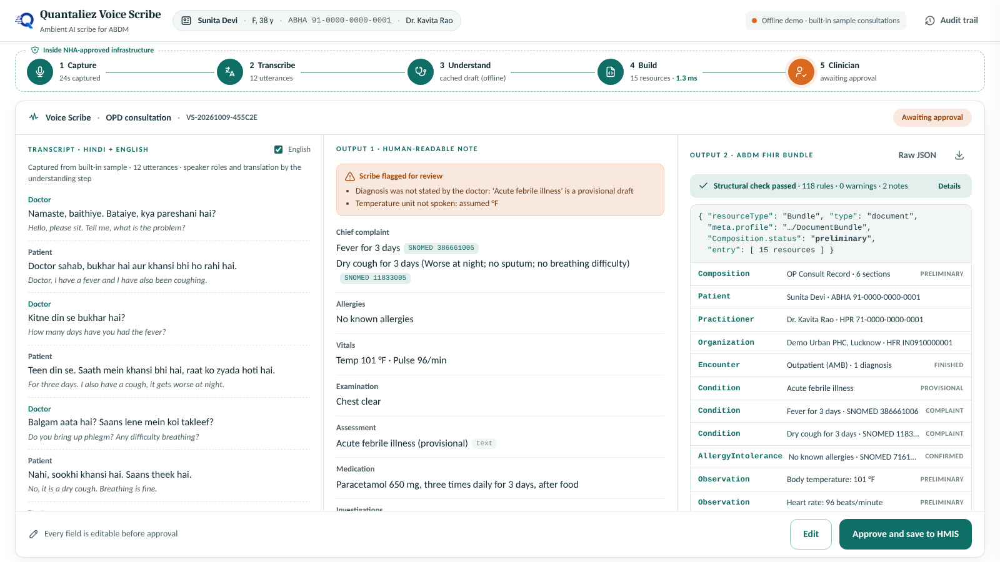

# Quantaliez Voice Scribe: working demo

A runnable demo of the pitch to NHA. The doctor talks to the patient, the scribe drafts an
**ABDM OP Consult Record (FHIR R4)**, and the doctor edits and approves it. It follows the
deck slide by slide:

| Deck | What you see in the demo |
|---|---|
| Slide 4: Capture → Transcribe → Understand → Build → Clinician approves | Five-step pipeline bar across the top, lighting up live with real timings |
| Slide 6: the doctor stays in the HMIS | A **demo HMIS** (OPD queue) → *Launch Voice Scribe* with patient context → the approved record comes back to the HMIS |
| Slide 7: Hindi + English, clinical entities | Hinglish consultations; speaker roles, English translation, symptoms, vitals, diagnosis, medicines (OD/BD/TDS/SOS), tests, follow-up |
| Slide 8: two outputs, every field editable | Three columns: transcript · human-readable note · ABDM FHIR bundle, with **Edit** and **Approve and save to HMIS** |
| Slide 9: open-source models, vLLM | All model calls go to an OpenAI-compatible API: Groq-hosted open-weight models in the demo, or vLLM by changing one URL |
| Slide 11: audit trail | Audit drawer: session start, transcription, every edit, approval, saved to HMIS |



Screenshots of every step are in `docs/screenshots/`, as a backup for the slides if a live demo isn't possible.

---

## Run it

Python 3.10 or newer.

**Windows (PowerShell)**
```powershell
python -m venv .venv
.venv\Scripts\activate
pip install -r requirements.txt
copy .env.example .env          # optional: add GROQ_API_KEY for live mode
python app.py
```

**macOS / Linux**
```bash
python3 -m venv .venv && source .venv/bin/activate
pip install -r requirements.txt
cp .env.example .env            # optional: add GROQ_API_KEY for live mode
python app.py
```
(or `uv sync && uv run python app.py`)

Open **http://127.0.0.1:8000**. This opens the demo HMIS; the scribe itself is at `/scribe`.

### Two modes

| | Offline demo (no key) | Live (GROQ_API_KEY in `.env`) |
|---|---|---|
| Sample consultations | ✓ scripted, with pre-computed drafts | ✓ the transcript goes to the live LLM |
| Microphone (Hindi/English) | – | ✓ Whisper large-v3, cut at pauses |
| Upload audio (WAV/MP3/FLAC/M4A…) | – | ✓ |
| LiveKit ambient agent | – | ✓ (see below) |
| FHIR build, validation, edit, approve, HMIS, audit | ✓ real code | ✓ real code |

The **offline mode cannot fail in front of a panel**: it needs no internet or key. In live mode,
if the model call fails on a sample, the app falls back to that sample's cached draft and says so.
Set `OFFLINE_DEMO=true` to force offline mode even if a key is present.

---

## Use it with your own voice and make real reports

1. **Turn on live mode.** Get a free key at https://console.groq.com/keys, put `GROQ_API_KEY=gsk_...` in `.env` and restart `python app.py`.
   The badge in the scribe turns green and reads **Live**.
2. **Put your details on the paperwork.** Set `DOCTOR_NAME`, `DOCTOR_QUALIFICATION`, `DOCTOR_REGISTRATION`, `FACILITY_NAME`,
   `FACILITY_ADDRESS` and `FACILITY_PHONE` in `.env` (see `.env.example`), then restart.
3. **Register the patient.** On the HMIS page, click **Register patient** and enter the name, age, sex, and optionally mobile and ABHA.
   This patient is stored only on your computer (`runtime/patients.json`).
4. **Record.** Click **Launch Voice Scribe**. For patients you register, **Microphone** is selected automatically in live mode.
   Press **Start consultation**, allow the mic in Chrome or Edge, and talk normally (Hindi, English or mixed). Then press **End consultation**.
   You can also upload a recording (WAV/MP3/FLAC/M4A, up to 25 MB) with **Upload**.
5. **Review, edit, approve**, then click **Open report (PDF)**. You get an A4 *OP Consultation Record & Prescription* with your
   letterhead, patient details, vitals, diagnosis, a ℞ table (1-0-1 schedule, duration, and patient instructions in Hindi),
   tests, advice, a follow-up date and an approval footer. Click **Print / Save as PDF**. Every saved record also has a
   **Report / PDF** link on the HMIS page, plus the FHIR JSON download.

Tips for good transcripts: sit close to the laptop mic or use a headset, and pause briefly between turns. Audio is sent in chunks
of about 5 seconds or more, which keeps a normal consultation within Groq's free-tier limits. If Hindi comes out in the wrong script, set `STT_LANGUAGE=hi` in `.env`.
The mic works on `http://127.0.0.1` / `localhost`; from another device on your network the browser needs HTTPS.

> **Privacy:** in live mode the audio and transcript go to Groq's API. Use your own voice or consenting test speakers, not real
> patients, until the models are self-hosted (e.g. vLLM on your own or NHA infrastructure: change `LLM_BASE_URL` / `STT_BASE_URL`).
> Reports are AI-drafted and must be checked by the doctor; this demo is not a certified medical device.

---

## Demo run-sheet (about 3 minutes, switch to it at slide 8)

Slide 8's speaker note says *"If a live demo is possible, this is the slide to switch to it."*

| # | Click | Say |
|---|---|---|
| 1 | Open `http://127.0.0.1:8000` (demo HMIS) | "The doctor stays in the HMIS they already use." (slide 6, steps 01–02) |
| 2 | **Launch Voice Scribe** on *Sunita Devi* | "Voice Scribe opens with the patient's context: ABHA, doctor, facility." |
| 3 | **Start consultation** (sample: *Fever and cough*) | "It listens in the background: Hindi and English, the way consultations really sound." Use the ⏩ button to fast-forward. |
| 4 | Wait for the draft | "AI drafts: speaker roles, English translation, clinical meaning, SNOMED CT / LOINC codes, and a FHIR R4 OP Consult Record, validated in milliseconds." |
| 5 | Point at the orange **Scribe flagged for review** box | "It tells the doctor what it inferred. Here the diagnosis was not stated, so it is marked provisional." |
| 6 | **Edit** → change Paracetamol from 3 to 5 days | "Every field is editable. The FHIR is rebuilt and re-validated on each edit (watch the MedicationRequest flash), and the edit is audited." |
| 7 | **Approve and save to HMIS** | "Nothing is saved until the doctor approves. The record becomes final, attested and signed." |
| 8 | **Audit trail** (top right) | "Who accessed what, every transcription, every edit, every approval." (slide 11) |
| 9 | **Return to HMIS** | "Saved in the HMIS, ready for consent-based sharing through ABDM." (slide 6, step 07) |

Optional, in live mode: choose **Microphone**, speak a short Hinglish exchange, then press **End consultation**.

**Before presenting:** click **Reset demo** on the HMIS page, set the browser to full screen (F11), and on a
1366×768 laptop zoom to 90%. The other samples (*Diabetes and BP follow-up*, *Sore throat dictation*) show
multiple medicines, a lab result, BD/OD/SOS dosing, and dictation mode.

---

## What changed from the Lauki voice agent

| Lauki Phones agent (original) | Quantaliez Voice Scribe (this demo) |
|---|---|
| LiveKit agent that **talks back** (STT → LangChain agent → TTS) | An ambient scribe **never speaks**. `voice_agent/ambient_scribe.py` keeps LiveKit STT only, raises `StopResponse` on every turn, and streams final transcripts to the scribe server |
| LangChain tool-calling agent decides what to do | Fixed, auditable pipeline. The LLM only *proposes* a structured draft (`scribe/understand.py`); deterministic code builds the FHIR (`scribe/fhir_builder.py`) |
| RAG over telecom PDFs (Docling + Qdrant + embeddings) | Exact terminology grounding to SNOMED CT / LOINC (`scribe/terminology.py`). Clinical codes come from a table lookup, never a nearest-neighbour guess |
| Mock customer DB, plan tools, escalation tickets | Patient context from the HMIS, FHIR validator, doctor approval, demo HMIS store, audit trail |
| Groq `gpt-oss-120b`, Deepgram via LiveKit | Same open-weight LLM through any OpenAI-compatible endpoint, plus Whisper large-v3 for STT. Swap to vLLM by changing `LLM_BASE_URL` / `STT_BASE_URL` |
| Terminal console only | Browser review workspace and demo HMIS (FastAPI + plain HTML/JS, no build step) |

Heavy dependencies (torch, sentence-transformers, docling, qdrant) are gone, so the install is small.

### Optional: LiveKit ambient mode (your original LiveKit setup)

```bash
pip install -r requirements-livekit.txt
# .env: LIVEKIT_URL, LIVEKIT_API_KEY, LIVEKIT_API_SECRET (as before) + GROQ_API_KEY
python app.py                                        # terminal 1
python -m voice_agent.ambient_scribe console         # terminal 2: listens on this computer's mic
```
In the scribe page choose **LiveKit** → **Start consultation**. Transcripts stream in, and **End consultation** drafts the record.
Use `dev` instead of `console` to join LiveKit rooms (e.g. a teleconsultation).

---

## How it works

```
Browser (HMIS → Voice Scribe)
   │  audio (mic segments / upload)  or  LiveKit agent → /api/ambient/segments
   ▼
app.py (FastAPI)
   ├─ scribe/stt.py           2 Transcribe   Whisper large-v3 (OpenAI-compatible /audio/transcriptions)
   ├─ scribe/understand.py    3 Understand   gpt-oss-120b → speaker roles, translation, ClinicalDraft (JSON)
   ├─ scribe/terminology.py      grounding   SNOMED CT / LOINC table lookup
   ├─ scribe/fhir_builder.py  4 Build        ABDM OP Consult Record: FHIR R4 document Bundle
   ├─ scribe/validator.py        check       structural rules, run on every edit
   └─ scribe/store.py         5 Approve      audit trail, demo HMIS records (./runtime)
```

The bundle contains Composition (OPConsultRecord profile, SNOMED 371530004), Patient (ABHA), Practitioner (HPR),
Organization (HFR), Encounter, Condition (complaints and diagnoses), AllergyIntolerance, Observation (vitals:
LOINC), ServiceRequest, MedicationRequest (structured dosage: frequency, duration, route) and Appointment
(follow-up). Before approval, statuses are `preliminary`/`draft`. After approval they are `final`/`active`,
with an attester and a signature block.

**API:** `GET /api/config` · `POST /api/sessions` · `POST /api/sessions/{id}/segments` · `POST /api/sessions/{id}/audio` ·
`POST /api/sessions/{id}/draft` · `PUT /api/sessions/{id}/draft` · `POST /api/sessions/{id}/approve` ·
`GET /api/sessions/{id}/bundle` · `GET /api/audit` · `POST /api/hmis/patients` · `GET /api/hmis/records` ·
`GET /api/hmis/records/{id}/bundle` · `GET /report/{record_id}` · `POST /api/demo/reset` · docs at `/docs`.

**Tests (offline, no key):** `python tests/test_pipeline.py` (or `pytest -q`) runs launch → capture → draft → edit → approve → HMIS.

---

## Limits of this demo (be ready for these questions)

- **Synthetic data, not for clinical use.** Patients, ABHA/HPR/HFR numbers and sample consultations are made up.
- **Live mode sends audio to a hosted API (Groq).** It runs the same open-weight models, but do not use real patient
  audio. In deployment these models are served with vLLM inside NHA-approved cloud, and only the endpoint URL changes.
- **Terminology is a demo subset** (~50 terms). The codes were spot-checked against tx.fhir.org, but should be verified
  against the SNOMED CT India / LOINC releases, and the table replaced with a terminology service. Medicines are kept
  as text (drug coding is left to the terminology service).
- **The FHIR check is structural** (references resolve, required fields, profiles declared, final records attested and signed).
  Production validates with the HL7 FHIR Validator and the NRCeS ABDM IG package. Section slices and codes follow the
  current NRCeS OPConsultRecord profile; re-check them against the IG version NHA mandates.
- **The signature is a placeholder**, and ABDM HIP/consent flows are stubbed ("ready to link").
- **Speaker roles are inferred by the LLM** from what is said, not by acoustic diarization.
- **The LiveKit agent** was import-checked against `livekit-agents` 1.8, and its endpoints were tested, but it was not run against a live LiveKit project.
